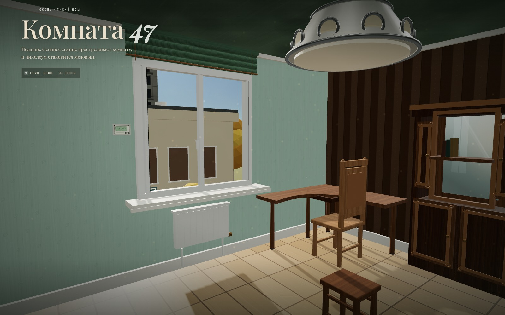
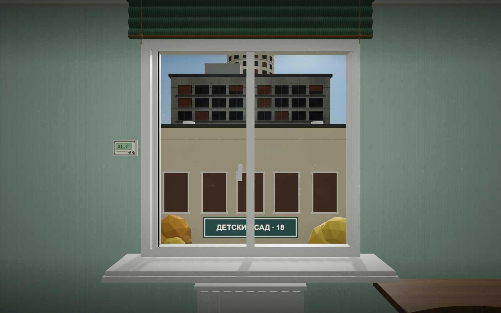
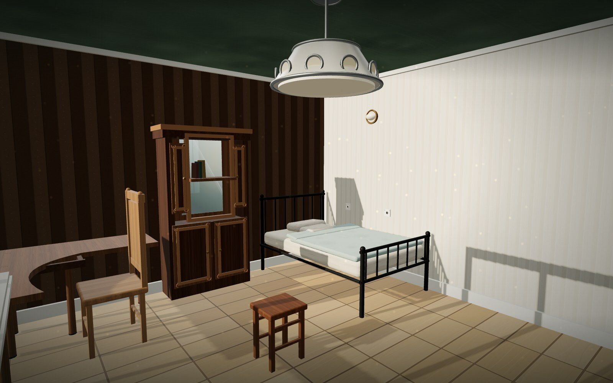
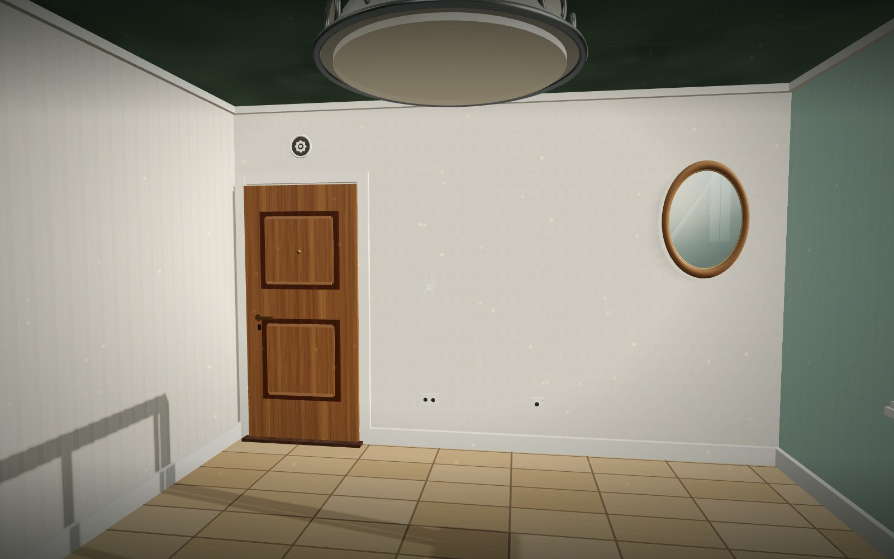

# Комната 47

**Живая сцена:** [zetnovs-0.github.io/soviet-room-47](https://zetnovs-0.github.io/soviet-room-47/)

Интерактивная 3D-сцена осенней комнаты: светлые обои на стене с дубовой дверью и овальным зеркалом, светло-изумрудная стена с окном и зелёными римскими шторами, коричневые полосатые обои со шкафом, светлая полосатая стена с железной кроватью. В центре — чехословацкая люстра-«НЛО» с иллюминаторами, зелёный потолок и светло-коричневый линолеум под прямоугольники. За окном — детский сад, девятиэтажка и круглая восемнадцатиэтажная башня. Всё построено кодом — в проекте нет ни одной внешней текстуры или 3D-модели.



<p align="center">
  
  
  
</p>

*An interactive 3D autumn room with an oak door, an oval mirror, emerald, brown-striped and light-striped wallpaper, green Roman blinds, a concave corner desk, a 120×190 iron bed and a Czechoslovak UFO chandelier with portholes. Outside are a kindergarten, a nine-storey block and a round eighteen-storey tower. Switch between morning, day, sunset and night; clear, cloudy, rain and snow. Built with Three.js, procedural canvas textures and small custom shaders. No external textures or 3D models.*

## Что внутри

- **Время суток:** утро, день, закат, ночь. Меняются положение солнца и луны, цвет неба, экспозиция, туман и свет в комнате.
- **Погода:** ясно, облачно, дождь, снег. Меняются небо, облака, освещение, окна соседних домов, капли и иней на стекле, снег на земле и деревьях.
- **Четыре стены:** дубовая дверь с панелями, латунной ручкой и глазком; выключатель, розетки и овальное зеркало; квадратное окно с вертикальной створкой и зелёными римскими шторами; коричневый шкаф с резными завитками, нишей, полкой и зеркалом; железная кровать 120×190 с подушками и одеялом.
- **Мебель:** большой вогнутый угловой стол, высокий деревянный стул, низкий табурет, шкаф у стены и маленький белый радиатор. Рядом с окном — цифровой термометр.
- **Люстра:** чехословацкая «НЛО» — усечённый цилиндр с иллюминаторами по окружности. Включается вручную или автоматически на закате и ночью.
- **Вид из окна:** двухэтажный детский сад с вывеской, девятиэтажный панельный дом и круглая восемнадцатиэтажная башня, жёлтые осенние деревья, забор, песочница и фонарь.
- **Свет и эффекты:** направленный солнечный и лунный свет с тенями, тёплые точечные источники, звёзды, дождь, снег, капли на стекле, морозные узоры и пыль в воздухе — небольшими GLSL-шейдерами.
- **Интерфейс:** адаптивная консоль, горячие клавиши, состояние сцены в адресе, диалог «О сцене», поддержка `prefers-reduced-motion`.

## Управление

| Действие | Клавиши / мышь |
| --- | --- |
| Осмотреться | перетащить мышью или пальцем |
| Приблизиться | колесо мыши / пинч |
| Время суток | `1` утро · `2` день · `3` закат · `4` ночь |
| Погода | `Q` ясно · `W` облачно · `E` дождь · `R` снег |
| Люстра | `L` |
| О сцене | кнопка `i` |

Если люстру не трогать вручную, она автоматически включается на закате и ночью и выключается днём. Ручное переключение отключает эту автоматику.

Состояние сцены сохраняется в адресе: `?t=sunset&w=rain&lamp=0`. Ссылку можно отправить другому человеку. Если параметра `lamp` нет, люстра работает в автоматическом режиме.

## Запуск локально

Проект статический, сборка не нужна. ES-модули требуют HTTP-сервера:

```bash
python3 -m http.server 8000
# откройте http://localhost:8000
```

Подойдёт любой статический сервер — `npx serve`, `php -S`, Caddy, nginx.

Нужен современный браузер с WebGL 2. Three.js подключается с CDN через import map, шрифты — с Google Fonts.

## Структура

```
index.html          разметка сцены и интерфейса
style.css           советская палитра, адаптивная консоль, анимации
src/main.js         рендерер, свет, переходы времени/погоды, UI
src/room.js         четыре стены, окно, дверь, мебель, люстра
src/outside.js      двор, детский сад, девятиэтажка, круглая башня, деревья
src/presets.js      пресеты времени суток и погоды
src/textures.js     процедурные canvas-текстуры
src/shaders.js      небо, стекло, дождь, снег, пыль
favicon.svg         иконка
preview.jpg         главное превью для README и Open Graph
preview-window.jpg  вид в окно
preview-bed.jpg     угол с кроватью и шкафом
preview-door.jpg    стена с дверью и зеркалом
```

## Публикация

Сайт разворачивается из корня ветки `main` через GitHub Pages. Файл `.nojekyll` отключает обработку Jekyll, поэтому статика отдаётся как есть.

## Лицензия

Код — [MIT](LICENSE). Шрифты Oswald и Playfair Display распространяются по лицензии SIL Open Font License, Three.js — по MIT.
